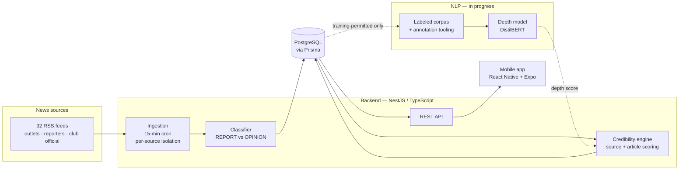

# FinalThird

**A football news app that tells you which transfer rumours to believe.**

FinalThird aggregates Premier League news and transfer reporting, and attaches a **Credibility Score**
to every source and every article: a number estimating how much a given claim should be trusted,
based on who reported it, how they sourced it, and how reliable they have been before.

> **Source code is private.** This repository documents the project's design, architecture and
> status. The codebase is available for review on request: [contact link].

---

## The problem

Football transfer news is a high-volume, low-signal environment. In a single transfer window the same
player can be "agreed", "close", "monitored" and "never available" depending on the outlet, and
aggregators like FotMob and Sofascore present all of it side by side with no indication of which
reports have historically been right.

Fans either learn by experience which journalists to trust, or they don't. FinalThird tries to make
that judgment explicit, consistent and checkable.

---

## Screenshots

| Feed | Reporter detail | Search & follow |
|---|---|---|
|  |  |  |

---

## Architecture

Dashed lines are planned, not yet live.

---

## Tech stack

| Layer | Technology |
|---|---|
| Mobile | React Native, Expo, TanStack Query — one codebase for iOS and Android |
| Backend | NestJS, TypeScript |
| Database | PostgreSQL, Prisma ORM |
| Ingestion | `rss-parser` on a scheduled job |
| Testing | Jest |
| Planned — NLP | Python, PyTorch, DistilBERT (fine-tuned for regression), FastAPI serving |
| Planned — infra | Railway (API + Postgres), Upstash Redis |

---

## How the Credibility Score works

Every **source** gets a score from 0 to 100, built from five factors:

- **Past accuracy** — how often the source's previous claims turned out to be true. The heaviest
  factor by design.
- **Source tier** — how close the source sits to the actual decision-makers. A club's own announcement
  outranks an insider, who outranks an aggregator repeating someone else.
- **Club rapport** — demonstrated access to the clubs and agents the source covers.
- **Reach adjustment** — an *inverse* factor. Larger platforms are penalised, because popularity is
  not accuracy and high-reach accounts are under pressure to publish first.
- **Recency** — a recent track record counts for more than an old one.

Every **article** then inherits its source's score, adjusted for properties of the article itself:
how far along the reported deal actually is, how many named sources it cites, and whether other
independent outlets corroborate it.

Design principles:

- **Scored stingily.** Scores start low and 80+ is rare. If everything scores well, the number means
  nothing.
- **Opinion is not scored.** Columns, rankings and analysis are classified separately and carry no
  score at all. Scoring an opinion piece low would be a category error — it isn't weak reporting,
  it isn't reporting.
- **Text and author are kept separate.** The planned NLP depth model never sees who wrote an article.
  Source reputation already enters through the source score; letting the model see the byline would
  teach it "famous reporter → high score" instead of reading the text, and count reputation twice.

*The exact weights and adjustment parameters are tuned internally and not published in this
repository.*

---

## Content acquisition — and what we don't do

A credibility product has to be trustworthy about its own sources, so ingestion is deliberately
conservative:

- **Headlines, summaries and links only.** Articles are never republished; every item links out to
  the original publisher, the same model as Apple News or Feedly.
- **Two separate permissions, checked per outlet.** A publisher's `robots.txt` can allow aggregation
  while forbidding use of its text for AI training — and many do. I built an audit tool that checks
  both for every outlet and records them separately. Only training-permitted sources can ever enter
  the NLP corpus.
- **No scraping of paywalled outlets**, at any volume. A product whose pitch is "we tell you which
  sources to believe" can't be built on journalism it didn't pay for.

From an audit of 100 outlets: 55 publish usable feeds, and 26 of the 32 sources currently live are
also cleared for model training.

---

## Status

### Finished

- Ingestion pipeline: scheduled RSS ingestion across 32 sources, per-source error isolation, database-
  level deduplication, failure tracking, soft-disable for dead feeds
- Credibility engine: source and article scoring, with a recompute endpoint and unit tests
- Report / Opinion classifier
- REST API and mobile app wired end to end — feed, reporter pages, search, follows
- Source audit tool covering 100 outlets for crawl and training permissions
- NLP labeling rubric, blind-annotation tool, and a labeled corpus of 400+ articles

### In progress

- Production hardening — input validation, pagination, API versioning, error handling, admin auth
- Deployment and app store submission
- **DistilBERT depth model** — fine-tuning on the labeled corpus to replace a fixed default with a
  learned article-depth score

### Planned

- Measured past accuracy: tracking whether each rumour came true and updating source scores from the
  outcomes, rather than from initial estimates
- Claim-level corroboration: treating "Player X to Club Y" as one claim reported by many outlets,
  so that agreement and contradiction between sources become signals
- Crediting cited reporters ("according to …") rather than only the article's author

---

## Engineering notes

A few problems from the build that shaped the design:

- **A CDN that always gzips.** One publisher's feed failed with a parse error on every path. The CDN
  force-compressed responses regardless of request headers, and the feed library's HTTP client never
  decompressed. Fixed by fetching with a client that does, then parsing the text — which protects
  every future source behind a similar CDN.
- **A 200 that meant nothing.** A club's feed linked to a domain that no longer resolved. Checking
  the replacement URLs by status code was useless: the site returns 200 for *any* path, including
  invented ones. Verified against the club's sitemap instead, then added a host-rewrite rule so the
  scheduled job doesn't reintroduce the dead links.
- **Two tools, two rounding rules.** A verification script and the production engine disagreed on
  one score out of 23 — because one rounded 50.5 down and the other rounded it up. The scoring
  engine's own recompute check caught it.
- **Crawl permission ≠ training permission.** The original assumption was one "allowed" flag per
  source. The audit showed publishers answer the two questions differently, which became a schema
  field and a hard filter on the training corpus.

---

Built by **Steve Lee** — sole engineer.
